<div align="center">

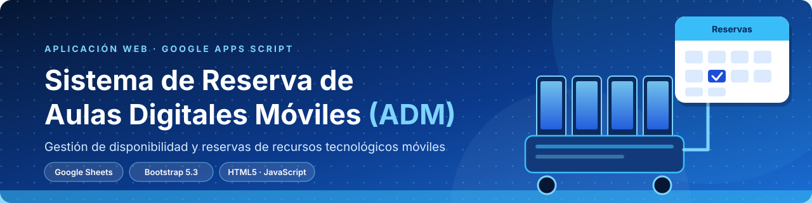

# Sistema de Reserva de Aulas Digitales Móviles (ADM)

**Aplicación web para consultar disponibilidad, registrar reservas y controlar la entrega de recursos tecnológicos móviles en una institución educativa.**

<p>
  
  
  
  
  
</p>

[Descripción](#1-descripción-general) · [Interfaces](#4-interfaces-del-sistema) · [Arquitectura](#8-arquitectura-del-sistema) · [Google Sheets](#10-organización-de-google-sheets) · [Instalación](#12-instalación-y-configuración) · [Seguridad](#13-seguridad-y-permisos)

</div>

---

## Índice de contenidos

1. [Descripción general](#1-descripción-general)
2. [Objetivos del sistema](#2-objetivos-del-sistema)
3. [Características principales](#3-características-principales)
4. [Interfaces del sistema](#4-interfaces-del-sistema)
5. [Funcionamiento de la vista docente](#5-funcionamiento-de-la-vista-docente)
6. [Funcionamiento del panel administrativo](#6-funcionamiento-del-panel-administrativo)
7. [Tecnologías utilizadas](#7-tecnologías-utilizadas)
8. [Arquitectura del sistema](#8-arquitectura-del-sistema)
9. [Estructura de archivos](#9-estructura-de-archivos)
10. [Organización de Google Sheets](#10-organización-de-google-sheets)
11. [Explicación de las funciones principales de Code.gs](#11-explicación-de-las-funciones-principales-de-codegs)
12. [Instalación y configuración](#12-instalación-y-configuración)
13. [Seguridad y permisos](#13-seguridad-y-permisos)
14. [Posibles mejoras futuras](#14-posibles-mejoras-futuras)

---

## 1. Descripción general

El **Sistema de Reserva de Aulas Digitales Móviles (ADM)** es una aplicación web pensada para organizar la solicitud y la asignación de los recursos tecnológicos móviles de una institución educativa.

La propuesta facilita la consulta de disponibilidad y el registro de reservas de los equipos, evitando que distintas personas soliciten el mismo recurso para una misma fecha y franja horaria. También incorpora una vista administrativa que permite consultar las reservas realizadas durante un día y generar una planilla para el control de entrega de los equipos.

El sistema está desarrollado con **Google Apps Script**, **HTML5** y **Bootstrap 5.3**, y utiliza una hoja de cálculo de **Google Sheets** para almacenar el inventario de equipos y los datos de las reservas.

### Datos clave

| | |
|---|---|
| **Tipo de aplicación** | Aplicación web |
| **Lógica del servidor** | Google Apps Script (`Code.gs`) |
| **Interfaces** | HTML5, Bootstrap 5.3 y JavaScript (`index.html` y `admin.html`) |
| **Almacenamiento** | Google Sheets (pestañas `Inventario` y `Reservas`) |
| **Vistas disponibles** | Vista docente y vista administrativa |
| **Acceso** | Dirección de la aplicación desplegada · `?vista=admin` para el panel administrativo |

---

## 2. Objetivos del sistema

| Objetivo | Cómo lo aborda el sistema |
|---|---|
| Organizar las reservas de las Aulas Digitales Móviles y sus recursos. | El inventario y las reservas se centralizan en una única hoja de Google Sheets. |
| Permitir que el docente consulte qué equipos están disponibles según fecha y horario. | La función `obtenerDisponibilidad(fecha, tramo)` devuelve los equipos libres, agrupados por tipo. |
| Registrar los datos necesarios para identificar cada reserva y a su responsable. | Cada reserva guarda un identificador, el equipo, el nombre del profesor, el curso o materia y una marca temporal. |
| Evitar que un mismo equipo se reserve dos veces para la misma fecha y franja horaria. | `guardarReserva(datos)` vuelve a comprobar la disponibilidad antes de registrar la reserva. |
| Facilitar la consulta diaria de reservas y la impresión de una planilla de entrega. | El panel administrativo lista las reservas de una fecha y permite imprimir la planilla. |

---

## 3. Características principales

| Característica | Descripción |
|---|---|
| **Consulta de disponibilidad** | El docente elige una fecha y una franja horaria y el sistema muestra las categorías de equipos con unidades libres. |
| **Reserva con datos del responsable** | Se registra el nombre del docente y el curso o materia para los que se solicita el equipo. |
| **Doble comprobación de disponibilidad** | La disponibilidad se consulta al buscar y se vuelve a comprobar al confirmar la reserva. |
| **Aviso ante conflicto** | Si el equipo ya no está disponible para esa fecha y horario, el sistema informa que debe seleccionarse otro. |
| **Confirmación con código** | Al registrarse la reserva se muestra el equipo reservado y un código de cancelación generado por el sistema. |
| **Inventario controlado desde Google Sheets** | Solo se consideran los equipos cuyo estado es `OPERATIVO`. |
| **Panel administrativo por fecha** | Permite consultar las reservas de un día, ordenadas por horario y con la categoría de cada equipo. |
| **Planilla imprimible** | Genera una planilla con espacio para la firma de recepción; al imprimir se ocultan los controles de pantalla. |
| **Interfaz adaptable** | Bootstrap 5.3 aporta los estilos y componentes de ambas vistas. |

> [!NOTE]
> El código de cancelación se genera y se muestra al usuario, pero la versión actual **no incluye una función de cancelación**. Esta capacidad figura entre las [mejoras futuras](#14-posibles-mejoras-futuras).

---

## 4. Interfaces del sistema

Las siguientes imágenes muestran las pantallas principales. Las capturas marcadas como **reales** corresponden al sistema en funcionamiento; las marcadas como **pendientes** son espacios preparados para incorporar capturas reales y **no representan la interfaz final**.

| Pantalla | Archivo | Estado |
|---|---|---|
| Pantalla principal de reservas y selección de fecha y horario | `assets/screenshots/vista-docente-fecha-horario.png` | Captura real |
| Selección de equipos disponibles | `assets/screenshots/vista-docente-equipos-disponibles.png` | Captura pendiente |
| Confirmación de reserva | `assets/screenshots/vista-docente-confirmacion.png` | Captura pendiente |
| Panel administrativo | `assets/screenshots/vista-admin-panel.png` | Captura real |
| Planilla de reservas para impresión | `assets/screenshots/vista-admin-planilla-impresion.png` | Captura pendiente |

### 4.1 Pantalla principal: selección de fecha y horario

La pantalla de inicio de la vista docente (titulada «Reserva de Equipamiento») reúne la selección de **fecha** y **horario**. El botón **Buscar Disponibles** consulta qué equipos pueden reservarse.

<p align="center">
  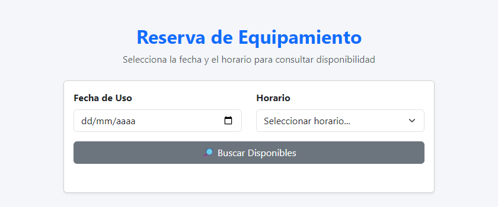
  <br>
  <sub><b>Figura 1.</b> Vista docente: selección de fecha y horario (captura real).</sub>
</p>

### 4.2 Selección de equipos disponibles

Tras la búsqueda, la vista docente muestra las categorías de equipos con unidades disponibles. El docente elige el equipo y completa su nombre y el curso o materia.

<p align="center">
  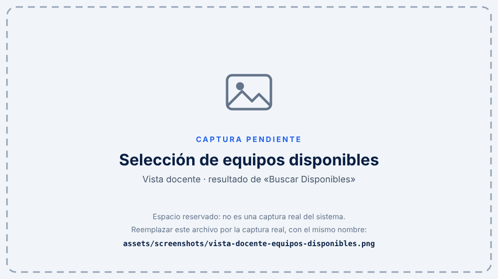
  <br>
  <sub><b>Figura 2.</b> Selección de equipos disponibles (captura pendiente de incorporar).</sub>
</p>

### 4.3 Confirmación de reserva

Cuando la reserva se registra correctamente, la aplicación muestra el equipo reservado y el código de cancelación generado por el sistema.

<p align="center">
  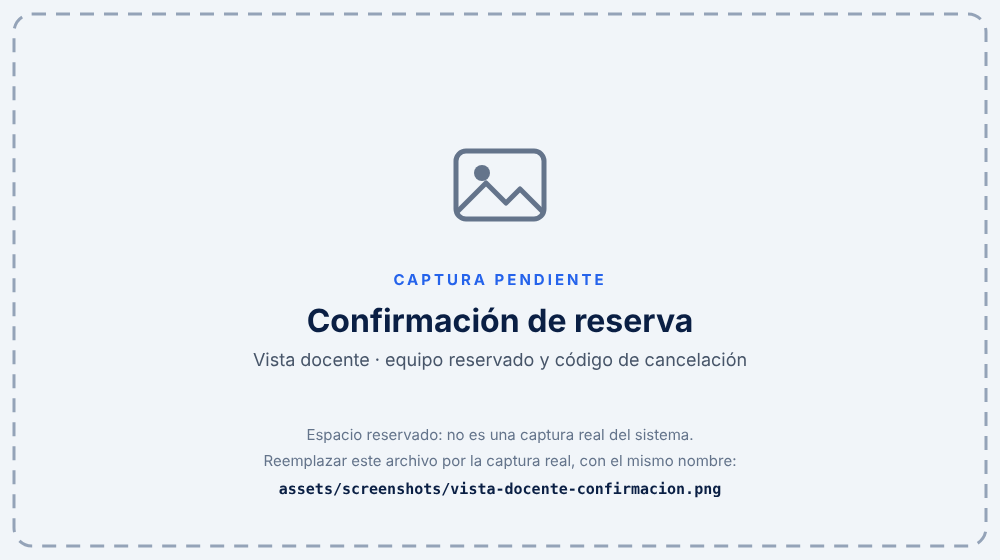
  <br>
  <sub><b>Figura 3.</b> Confirmación de reserva (captura pendiente de incorporar).</sub>
</p>

### 4.4 Panel administrativo

El panel «Control de Entrega de Equipos» permite elegir la fecha en **Ver reservas del día** y consulta las reservas en una tabla con las columnas *Módulo Horario*, *Equipo / ID*, *Categoría (Tipo)*, *Profesor*, *Curso/Materia* y *Firma de Recepción*. El botón **Imprimir Planilla** prepara la hoja de entrega.

<p align="center">
  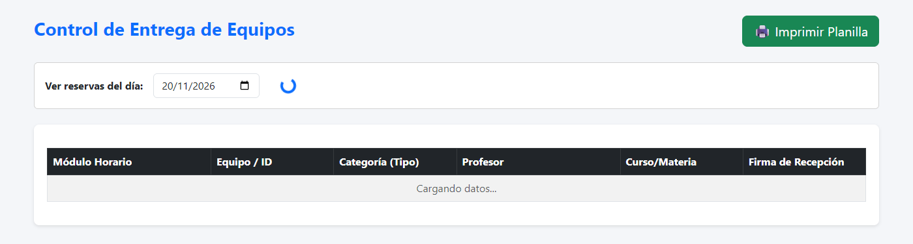
  <br>
  <sub><b>Figura 4.</b> Panel administrativo (captura real, tomada durante la carga inicial: la tabla indica «Cargando datos…»).</sub>
</p>

### 4.5 Planilla de reservas para impresión

Al imprimir, se ocultan los controles de pantalla y la información se presenta en un formato adecuado para el registro de entrega.

<p align="center">
  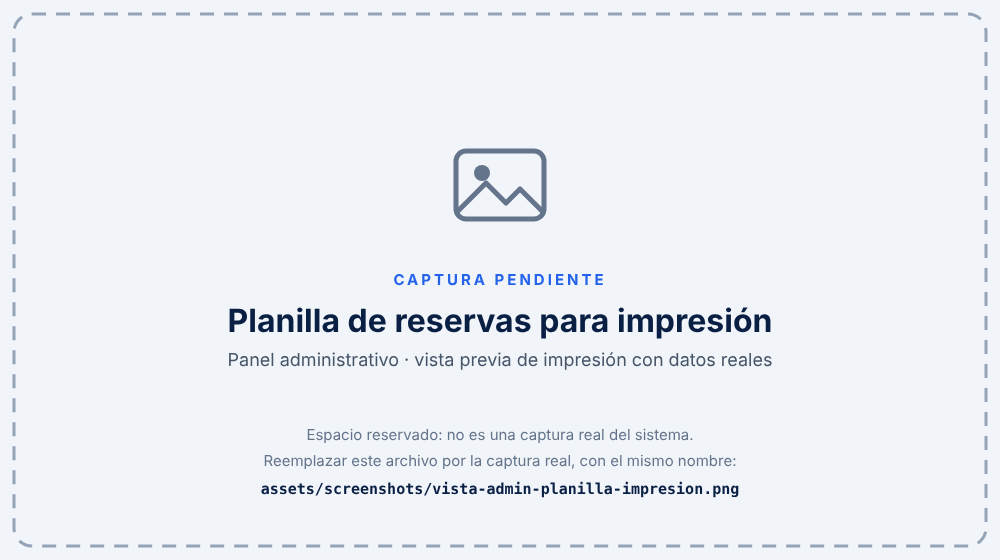
  <br>
  <sub><b>Figura 5.</b> Planilla para impresión (captura pendiente de incorporar).</sub>
</p>

---

## 5. Funcionamiento de la vista docente

Es la interfaz destinada a realizar una reserva. Se encuentra en la dirección principal de la aplicación desplegada.

### 5.1 Paso a paso

1. El usuario selecciona una **fecha** y una **franja horaria**.
2. El sistema consulta los datos guardados en Google Sheets y muestra las **categorías de equipos que tienen unidades disponibles**.
3. El docente elige el equipo y completa su **nombre** y el **curso o materia** correspondiente.
4. Al confirmar, la aplicación **vuelve a comprobar la disponibilidad** y registra la reserva en la hoja de cálculo.
5. Si el equipo ya no está disponible para esa fecha y horario, el sistema informa que debe seleccionarse otro.
6. Si la operación se registra correctamente, se muestra una **confirmación** con el equipo reservado y un **código de cancelación** generado por el sistema.

### 5.2 Diagrama de flujo

<p align="center">
  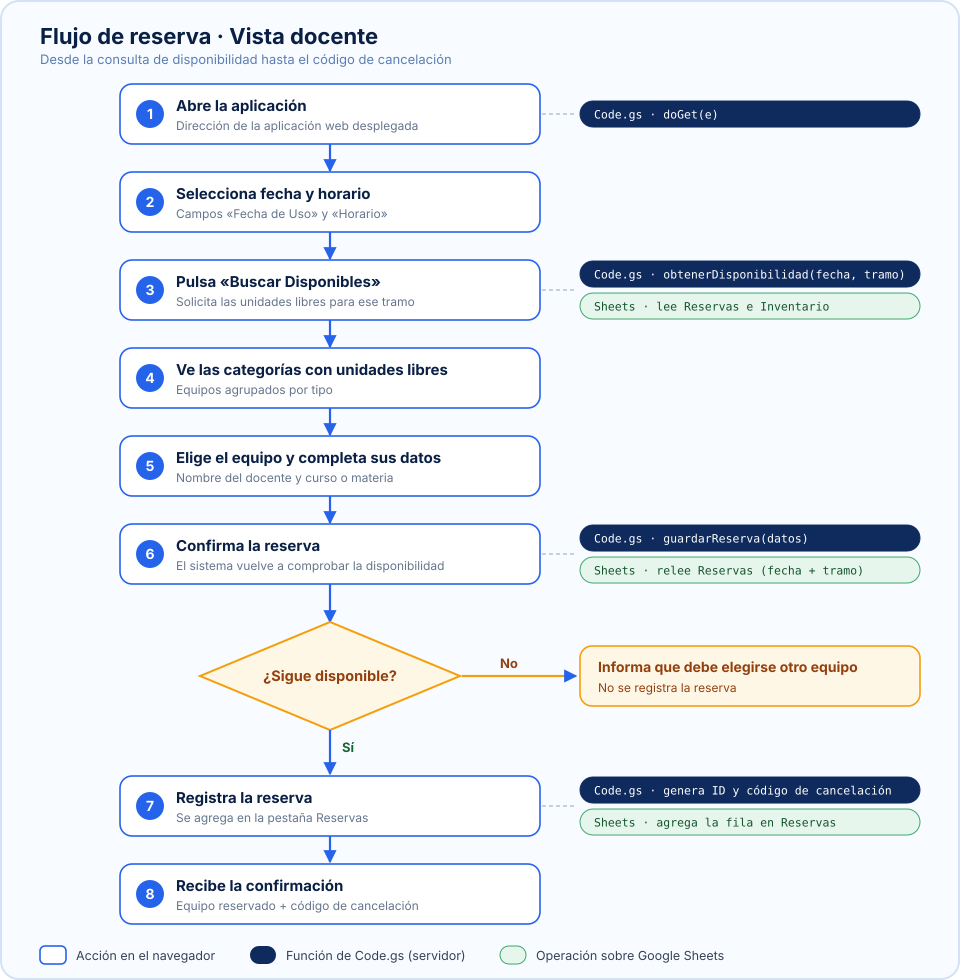
  <br>
  <sub><b>Figura 6.</b> Flujo de reserva en la vista docente.</sub>
</p>

### 5.3 Secuencia de comunicación entre componentes

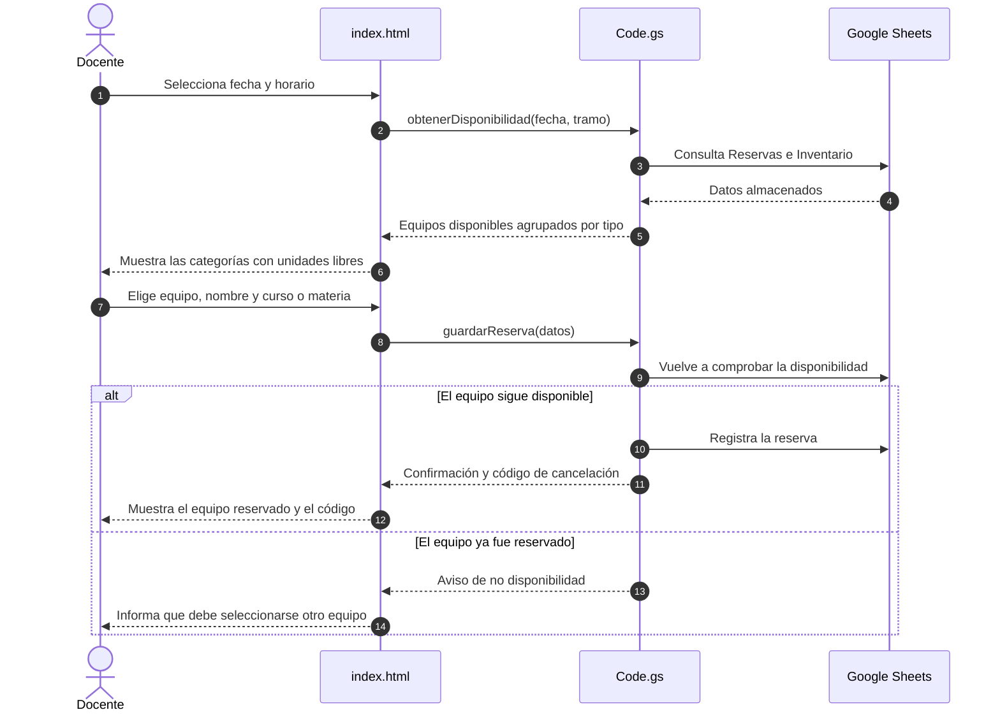

> [!TIP]
> **Por qué se comprueba dos veces.** La primera consulta es informativa: muestra lo que está libre en ese momento. Como otra persona podría reservar el mismo equipo mientras el docente completa sus datos, `guardarReserva(datos)` vuelve a verificar la disponibilidad en el servidor justo antes de registrar.

---

## 6. Funcionamiento del panel administrativo

Está destinado al control de las reservas. Se accede agregando `?vista=admin` a la dirección de la aplicación.

### 6.1 Paso a paso

1. El usuario selecciona una **fecha**.
2. El sistema consulta los registros de ese día mediante `obtenerReservasDelDia(fechaBuscada)`.
3. El servidor agrega la **categoría** de cada equipo y **ordena** los resultados por horario.
4. La información se presenta en una tabla.
5. Con **Imprimir Planilla** se ocultan los controles de pantalla y se presenta la información en un formato adecuado para el registro de entrega.

### 6.2 Columnas de la tabla

| Columna en pantalla | Contenido | Origen |
|---|---|---|
| Módulo Horario | Franja horaria de la reserva | Pestaña `Reservas` (Tramo) |
| Equipo / ID | Identificador del equipo | Pestaña `Reservas` (ID ADM) |
| Categoría (Tipo) | Categoría del equipo | Pestaña `Inventario` (Tipo) |
| Profesor | Nombre del docente solicitante | Pestaña `Reservas` (Profesor) |
| Curso/Materia | Curso o materia indicada en la reserva | Pestaña `Reservas` (Curso) |
| Firma de Recepción | Espacio para firmar la recepción del equipo | No proviene de la hoja de cálculo |

### 6.3 Diagrama de flujo

<p align="center">
  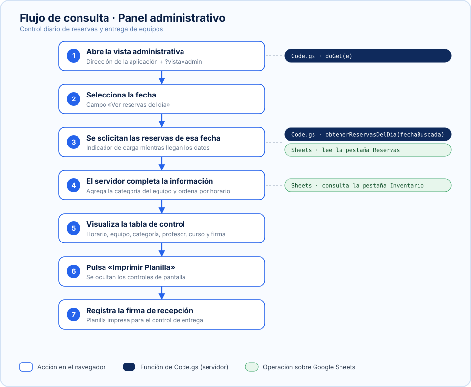
  <br>
  <sub><b>Figura 7.</b> Flujo de consulta e impresión en el panel administrativo.</sub>
</p>

---

## 7. Tecnologías utilizadas

<p align="center">
  
  
  
  
  
</p>

| Tecnología | Función dentro del proyecto | Dónde se utiliza |
|---|---|---|
| **Google Apps Script** | Ejecuta la lógica del servidor y conecta la aplicación con Google Sheets. | `Code.gs` |
| **JavaScript** | Procesa las consultas, valida la disponibilidad y gestiona las interacciones de las interfaces. | `Code.gs`, `index.html`, `admin.html` |
| **HTML5** | Define la estructura de las vistas docente y administrativa. | `index.html`, `admin.html` |
| **Bootstrap 5.3** | Aporta estilos y componentes para una interfaz adaptable. | `index.html`, `admin.html` |
| **Google Sheets** | Almacena el inventario de equipos y las reservas realizadas. | Hoja de cálculo con las pestañas `Inventario` y `Reservas` |

---

## 8. Arquitectura del sistema

El sistema sigue un modelo **cliente-servidor en tres capas**: una capa de presentación (las páginas HTML que se ejecutan en el navegador), una capa de lógica (Google Apps Script) y una capa de datos (Google Sheets). El navegador no accede directamente a la hoja de cálculo: toda lectura y escritura pasa por las funciones de `Code.gs`.

<p align="center">
  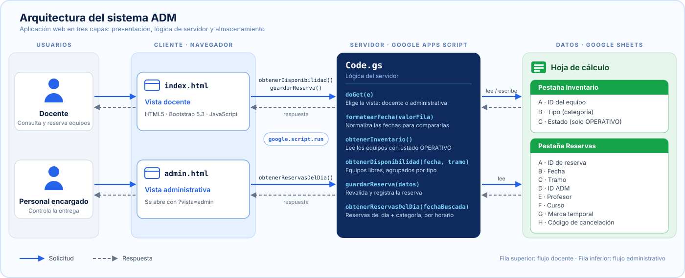
  <br>
  <sub><b>Figura 8.</b> Arquitectura general. La fila superior representa el flujo docente y la inferior, el flujo administrativo.</sub>
</p>

### 8.1 Capas y responsabilidades

| Capa | Componentes | Responsabilidad |
|---|---|---|
| **Presentación** | `index.html`, `admin.html` | Mostrar formularios y tablas, recibir las acciones del usuario y presentar las respuestas del servidor. |
| **Lógica** | `Code.gs` (Google Apps Script) | Elegir la vista, consultar disponibilidad, validar y registrar reservas, y recuperar las reservas de un día. |
| **Datos** | Google Sheets (`Inventario`, `Reservas`) | Almacenar de forma persistente los equipos y las reservas. |

### 8.2 Flujos principales

- **Flujo docente:** Docente → Interfaz HTML (`index.html`) → Google Apps Script (`Code.gs`) → Google Sheets, y regreso de la respuesta por el mismo camino.
- **Flujo administrativo:** Personal encargado → Interfaz HTML (`admin.html`) → Google Apps Script (`Code.gs`) → Google Sheets, y regreso de la información para armar la tabla y la planilla.

### 8.3 Comunicación entre cliente y servidor

La función `doGet(e)` decide qué página se entrega al abrir la aplicación. A partir de allí, las interfaces solicitan operaciones a las funciones del servidor (en Apps Script, este puente se establece con `google.script.run`) y reciben una respuesta con la que actualizan la pantalla.

### 8.4 Decisiones de diseño destacadas

- **Una sola dirección, dos vistas:** `doGet(e)` elige la interfaz según el parámetro `vista`, lo que evita mantener dos aplicaciones separadas.
- **Validación en el servidor:** la comprobación definitiva de disponibilidad ocurre en `Code.gs` al guardar, no solo en el navegador.
- **Hoja de cálculo como almacenamiento:** el inventario y las reservas pueden revisarse directamente en Google Sheets, sin necesidad de un motor de base de datos adicional.

---

## 9. Estructura de archivos

```text
Sistema-Reservas-ADM/
├── Code.gs
├── index.html
├── admin.html
├── README.md
└── assets/
    ├── banner.svg
    ├── diagrams/
    │   ├── arquitectura-sistema.svg
    │   ├── flujo-vista-docente.svg
    │   └── flujo-panel-administrativo.svg
    └── screenshots/
        ├── vista-docente-fecha-horario.png
        ├── vista-docente-equipos-disponibles.png
        ├── vista-docente-confirmacion.png
        ├── vista-admin-panel.png
        └── vista-admin-planilla-impresion.png
```

| Archivo o carpeta | Descripción |
|---|---|
| **`Code.gs`** | Lógica del servidor: gestiona la carga del inventario, la consulta de disponibilidad, el registro de reservas y la consulta de reservas por fecha. |
| **`index.html`** | Interfaz para que los docentes consulten disponibilidad y realicen reservas. |
| **`admin.html`** | Panel administrativo para consultar e imprimir la planilla diaria. |
| **`README.md`** | Documenta el propósito, el funcionamiento y la configuración del proyecto. |
| **`assets/`** | Recursos gráficos de la documentación (banner, diagramas y capturas). **No forman parte de la aplicación**: no se copian al proyecto de Apps Script. |

---

## 10. Organización de Google Sheets

La aplicación necesita una hoja de cálculo con **dos pestañas cuyos nombres deben coincidir exactamente** con los siguientes. En ambas, la primera fila se utiliza como encabezado y los datos comienzan en la segunda fila.

### 10.1 Pestaña `Inventario`

Contiene los equipos que pueden reservarse. El código utiliza estas columnas, en este orden:

| Columna | Dato | Descripción |
|:---:|---|---|
| **A** | ID | Identificador único del equipo o recurso. |
| **B** | Tipo | Categoría del recurso, por ejemplo, `ADM_v5`, `ADM_v10` o `ADM_v20`. |
| **C** | Estado | Estado del recurso. Solo se consideran los registros cuyo estado sea `OPERATIVO`. |

### 10.2 Pestaña `Reservas`

Almacena los registros generados por el sistema. El código utiliza estas columnas, en este orden:

| Columna | Dato | Descripción |
|:---:|---|---|
| **A** | ID de reserva | Código identificador del registro. |
| **B** | Fecha | Fecha para la que se solicita el equipo. |
| **C** | Tramo | Franja horaria seleccionada. |
| **D** | ID ADM | Identificador del equipo reservado. |
| **E** | Profesor | Nombre del docente solicitante. |
| **F** | Curso | Curso o materia indicada en la reserva. |
| **G** | Marca temporal | Fecha y hora en que se registró la operación. |
| **H** | Código de cancelación | Código generado al confirmar la reserva. |

### 10.3 Relación entre las pestañas

El valor de la columna **D** de `Reservas` (ID ADM) identifica un equipo de la columna **A** de `Inventario` (ID). Esa correspondencia es la que permite mostrar la categoría de cada equipo en el panel administrativo.

> [!IMPORTANT]
> La aplicación depende de que las pestañas y columnas mantengan exactamente la estructura indicada. Cambiar nombres, mover columnas o alterar el orden puede impedir su funcionamiento.

---

## 11. Explicación de las funciones principales de Code.gs

| Función | Parámetro | Responsabilidad | Vista que la utiliza |
|---|---|---|---|
| `doGet(e)` | `e` (solicitud) | Determina qué interfaz se debe mostrar. | Ambas |
| `formatearFecha(valorFila)` | `valorFila` | Normaliza el formato de las fechas para poder compararlas. | Apoyo interno |
| `obtenerInventario()` | — | Obtiene los recursos de la pestaña `Inventario` y filtra aquellos cuyo estado sea operativo. | Apoyo interno |
| `obtenerDisponibilidad(fecha, tramo)` | `fecha`, `tramo` | Consulta las reservas existentes para una fecha y franja horaria y devuelve los equipos que todavía están disponibles, agrupados por tipo. | Docente |
| `guardarReserva(datos)` | `datos` | Comprueba nuevamente la disponibilidad, genera los identificadores correspondientes y guarda la reserva en Google Sheets. | Docente |
| `obtenerReservasDelDia(fechaBuscada)` | `fechaBuscada` | Recupera las reservas de una fecha, agrega la categoría del equipo y ordena los resultados por horario. | Administrativa |

### 11.1 Selección de la vista con `doGet(e)`

Si la solicitud recibe el parámetro `vista=admin`, carga el panel administrativo; de lo contrario, muestra la vista docente.

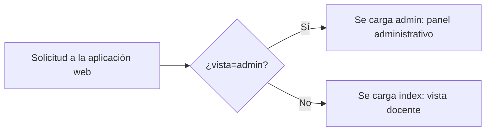

### 11.2 Apoyo interno

- **`formatearFecha(valorFila)`** normaliza las fechas para que puedan compararse de forma consistente (por ejemplo, la fecha solicitada con la almacenada en la hoja).
- **`obtenerInventario()`** considera únicamente los equipos con estado `OPERATIVO`; los demás no aparecen como reservables.

### 11.3 Operaciones de la vista docente

- **`obtenerDisponibilidad(fecha, tramo)`** es una consulta: no modifica la hoja.
- **`guardarReserva(datos)`** es la operación que escribe en `Reservas`. Antes de hacerlo, vuelve a comprobar la disponibilidad.

### 11.4 Operación de la vista administrativa

- **`obtenerReservasDelDia(fechaBuscada)`** devuelve los registros de una fecha, completados con la categoría del equipo y ordenados por horario, listos para mostrarse en la tabla y en la planilla.

---

## 12. Instalación y configuración

### 12.1 Requisitos

- Una cuenta de Google con acceso a **Google Apps Script** y **Google Sheets**.

### 12.2 Pasos

1. **Crear una hoja de cálculo de Google.**
2. **Crear las pestañas `Inventario` y `Reservas`**, respetando los nombres y el orden de las columnas explicados en la [sección 10](#10-organización-de-google-sheets).
3. **Abrir [Google Apps Script](https://script.google.com/)** y crear un proyecto.
4. **Copiar el contenido de `Code.gs`** en el archivo de script.
5. **Crear dos archivos HTML** en el proyecto con los nombres `index` y `admin` (sin agregar la extensión `.html` en el editor).
6. **Copiar el contenido de `index.html` y `admin.html`** en sus archivos correspondientes.
7. **Reemplazar el valor de `SPREADSHEET_ID`** en `Code.gs` por el identificador de la hoja de cálculo que se utilizará. Ese identificador es el fragmento de la dirección de la hoja ubicado entre `/d/` y `/edit`:

   ```text
   https://docs.google.com/spreadsheets/d/<ID_DE_LA_HOJA_DE_CALCULO>/edit
   ```

8. **Guardar los cambios y desplegar el proyecto como aplicación web**, configurando cuidadosamente quién puede acceder y con qué cuenta se ejecutará (ver la [sección 13](#13-seguridad-y-permisos)).

> [!TIP]
> En Apps Script, los cambios realizados al código después del despliegue se reflejan en la dirección publicada al crear una nueva versión de la implementación.

### 12.3 Direcciones de acceso

| Vista | Dirección |
|---|---|
| **Vista docente** | La dirección web de la aplicación desplegada. |
| **Vista administrativa** | La misma dirección, agregando `?vista=admin` al final. |

### 12.4 Verificación posterior a la instalación

- [ ] La vista docente carga y muestra los campos de fecha y horario.
- [ ] Al buscar disponibilidad aparecen las categorías con equipos `OPERATIVO`.
- [ ] Al confirmar una reserva se agrega una fila en la pestaña `Reservas`.
- [ ] La vista administrativa (`?vista=admin`) lista las reservas de la fecha elegida.
- [ ] La planilla se imprime sin los controles de pantalla.

---

## 13. Seguridad y permisos

> [!WARNING]
> El parámetro `?vista=admin` **solamente selecciona la interfaz administrativa**; por sí solo **no constituye un mecanismo de autenticación ni de protección**. Antes de utilizar el sistema con información real, se deben configurar los permisos de acceso de la aplicación y agregar un control de autorización adecuado para restringir las funciones administrativas.

| Aspecto | Consideración |
|---|---|
| **Identificador de Google Sheets** | Debe configurarse en el proyecto de Apps Script y **no publicarse en un repositorio público**. En este repositorio solo aparece un valor de ejemplo. |
| **Datos sensibles** | No se deben subir contraseñas, claves, tokens ni datos personales o institucionales reales. |
| **Acceso a la vista administrativa** | Requiere configurar permisos de despliegue y un control de autorización propio (ver la advertencia anterior). |
| **Permisos de despliegue** | Al desplegar la aplicación web hay que definir con cuidado quién puede acceder y con qué cuenta se ejecuta. |
| **Código de cancelación** | Se genera y se muestra al usuario al registrar la reserva, pero no existe una operación de anulación implementada en los archivos incluidos. |
| **Estructura de la hoja** | La aplicación depende de que las pestañas y columnas mantengan la estructura indicada en la [sección 10](#10-organización-de-google-sheets). |

---

## 14. Posibles mejoras futuras

Esta versión permite consultar disponibilidad, registrar reservas y visualizar e imprimir las reservas correspondientes a una fecha. La información se centraliza en Google Sheets, mientras que Google Apps Script realiza las operaciones entre las interfaces HTML y la planilla.

**Alcance actual**

- [x] Consulta de disponibilidad por fecha y franja horaria.
- [x] Registro de reservas con comprobación de disponibilidad.
- [x] Generación y visualización de un código de cancelación.
- [x] Panel administrativo con consulta de reservas por fecha.
- [x] Impresión de la planilla de control de entrega.

**Propuestas para futuras versiones** *(todavía no implementadas)*

| Mejora | Qué aportaría |
|---|---|
| Autenticación de usuarios | Identificar quién utiliza el sistema y proteger las funciones administrativas. |
| Permisos diferenciados | Separar lo que puede hacer un docente de lo que puede hacer el personal encargado. |
| Cancelación de reservas | Dar uso al código de cancelación que hoy solo se genera y se muestra. |
| Edición de registros | Corregir reservas sin modificar la hoja de cálculo manualmente. |
| Reportes | Obtener resúmenes de uso de los equipos. |
| Historial de movimientos de los equipos | Conservar un registro de los movimientos de los equipos a lo largo del tiempo. |

---

<div align="center">

**Proyecto:** Sistema de Reserva de Aulas Digitales Móviles (ADM)  
**Tipo de aplicación:** Aplicación web  
**Desarrollo:** Google Apps Script, JavaScript, HTML5 y Bootstrap 5.3  
**Almacenamiento:** Google Sheets

<sub>[Volver al índice](#índice-de-contenidos)</sub>

</div>
